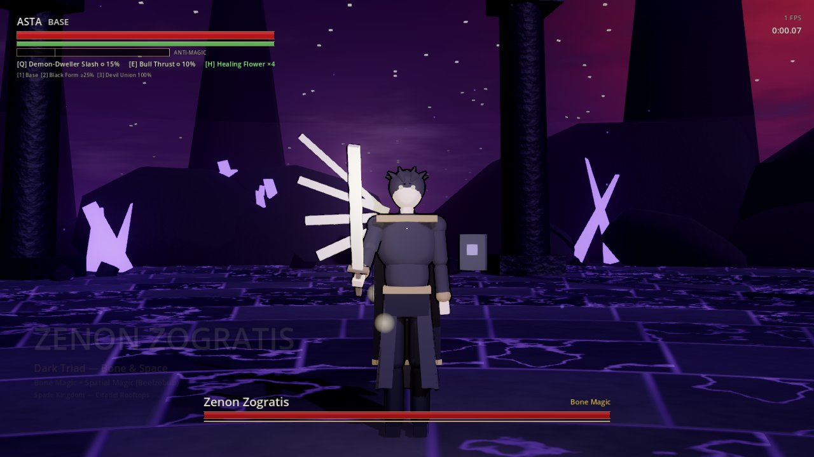
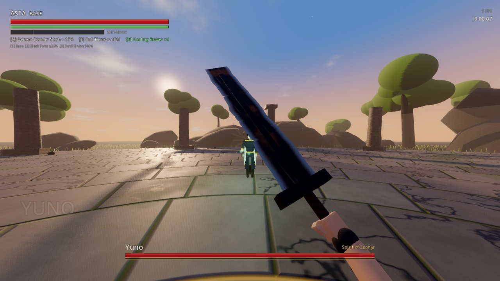
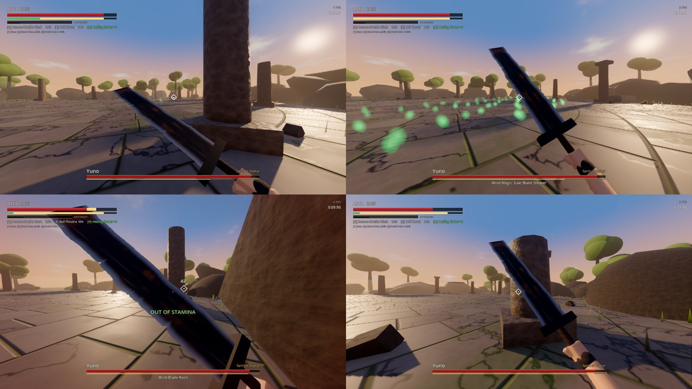
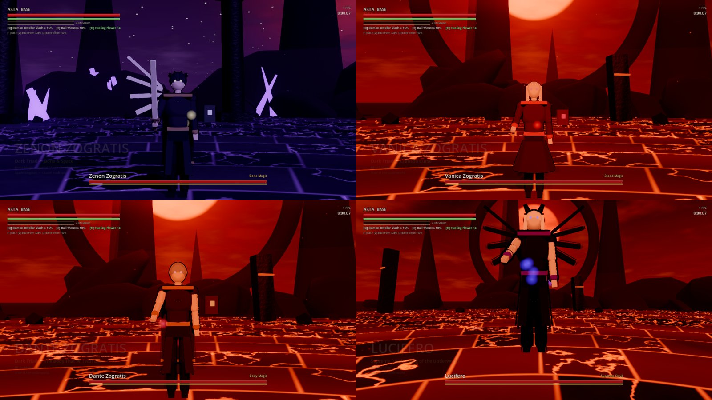

# Anti-Magic: Limit Breaker

A first-person, soulslike boss-rush RPG where you play as **Asta**. Fight the cast of the Black Clover
season 2 Spade Kingdom arc in any order you like. Built in **Godot 4.5** for high-refresh PC play,
with a target of 240 FPS.

> Personal, non-commercial fan project. Black Clover © Yūki Tabata / Shueisha. Every model, effect
> and sound in this repo is original and procedurally generated. No official assets are used. Please
> don't sell or redistribute builds.

| | |
|---|---|
|  |  |




*Screenshots come from a software (CPU) renderer in CI, so the FPS counter reads 1–3. On a real GPU you get
volumetric fog, SSAO and full frame rate.*

## What's in it

| | |
|---|---|
| **Play as Asta, first person** | Huge chipped Demon-Slayer sword with weighty eased animations, sword trails, hit-stop, camera shake and head-bob. |
| **3 forms, switched live** (`1` `2` `3`) | **Base**: steady and heavy. **Black Form**: faster, double-jump, Black Meteorite dashes; drains the anti-magic gauge. **Devil Union**: dual swords (Demon-Slasher + Demon-Destroyer), hyper armor, air dash; needs a full gauge. |
| **6 abilities** (`Q` `E` per form) | Demon-Dweller Slash, Bull Thrust, Black Divider, Black Hurricane, Demon-Destroyer Rush, Black Clover Slash. |
| **Soulslike combat** | Stamina, i-frame dodges, block, an 0.18 s **perfect parry** that reflects spells, poise/stagger with critical hits, input buffering, 4 heal charges. **Anti-magic**: your sword cuts any spell it touches. |
| **8 bosses, 19 phases** | Yuno, Noelle, Yami, Nacht, Zenon, Vanica, Dante, Lucifero. Each has canon magic and move names, phase transitions and readable telegraphs. |
| **RPG progression** | XP, levels, and four stats (Vigor, Endurance, Strength, Anti-Magic) in the Grimoire. 3 difficulties. |
| **4 arenas** | Clover Forest ruins, Spade Citadel rooftops, the Underworld Gate, Black Bull training canyon. |
| **Front end + back end** | Godot client; Python + SQLite local backend for saves, fight history, leaderboards and stats. Falls back to local saves when the backend is offline. |
| **Agent team** | 14 Claude Code subagents for assets (art, characters, weapons, animation, VFX, environments, audio) and code (gameplay, bosses, performance, UI, backend, QA). See [`.claude/agents`](.claude/agents). |

## Run it on your PC (Windows)

1. Install **Godot 4.5.1 (standard, not .NET)** from https://godotengine.org/download (a single .exe, no installer).
2. Optional: install **Python 3.10+** for the backend.
3. Clone this repo, then either:
   - double-click `play.bat`. It starts the backend if Python is present, then launches the game; set `GODOT` inside the file to your Godot .exe path. Or
   - open Godot, choose **Import**, pick `game/project.godot`, then press **F5**.
4. To build a standalone `.exe`: in Godot, go to **Editor → Manage Export Templates → Download**, then **Project → Export → Windows Desktop → Export Project**.

### Hitting 240 Hz
Settings → Exclusive fullscreen **on**, VSync **off**, frame cap **240**, quality **High**. Use **Ultra** (SDFGI GI,
SSIL, SSR) only on a high-end GPU. Render scale below 100% enables FSR 2. Physics runs at 240 Hz to match.

## Controls

| Action | Keyboard / mouse | Gamepad |
|---|---|---|
| Move / look | WASD / mouse | Left / right stick |
| Light attack (combo) | LMB | RB |
| Heavy attack | R / Mouse 4 | RT |
| Block, perfect parry on impact | RMB | LB |
| Dodge (i-frames) | Shift | B |
| Jump | Space | A |
| Sprint | Ctrl | L3 |
| Ability 1 / 2 | Q / E | X / Y |
| Base / Black Form / Devil Union | 1 / 2 / 3 | D-pad ← ↑ → |
| Heal (Healing Flower) | H or F | D-pad ↓ |
| Lock on | T / MMB | R3 |
| Pause | Esc | Start |

## Development

```bash
tools/test.sh                 # headless Godot suite: data checks + a bot fights all 8 bosses + every attack forced once; backend tests
tools/test.sh --boss=zenon    # one boss
tools/capture.sh yuno "4,8" --near           # screenshots -> captures/
python backend/server.py      # backend on http://127.0.0.1:8765
```
`GODOT=/path/to/godot` overrides the binary. Launch flags for the game, passed after `--`: `--boss=<id>`, `--autoplay`, `--quality=ultra`.

Docs: [Design](docs/DESIGN.md) · [Architecture](docs/ARCHITECTURE.md) · [Asset pipeline + agents](docs/ASSET_PIPELINE.md)
